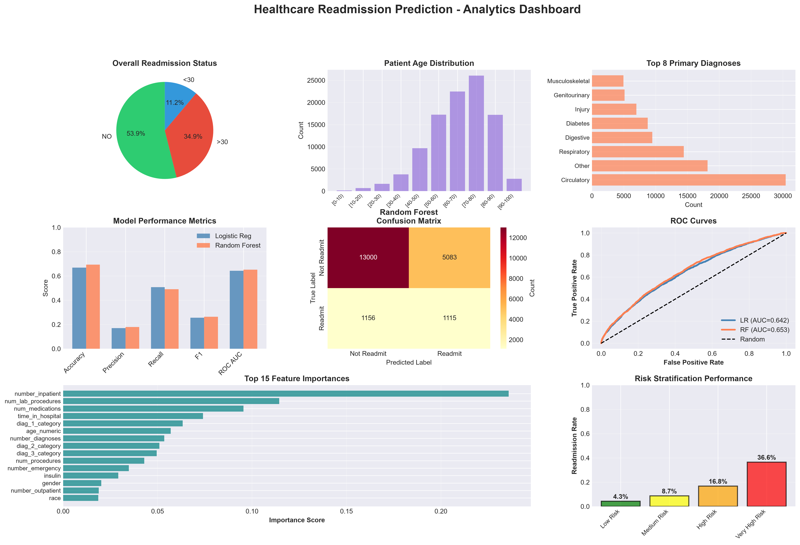
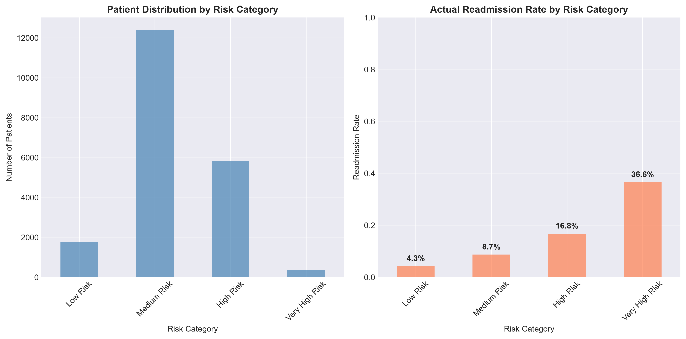

# 🏥 Predicting 30-Day Hospital Readmissions for Diabetic Patients

An end-to-end data analysis and machine learning project on **101,766 hospital encounters** from 130 US hospitals. The goal is to understand what drives early (<30 day) readmission in diabetic patients and to build a model that flags high-risk patients at discharge, so care teams can focus follow-up resources where they matter most.



---

## 📌 Highlights

| | |
|---|---|
| **Data** | 101,766 encounters · 71,518 unique patients · 50 features · 1999–2008 |
| **Target** | 30-day readmission (11.16% of encounters, 7.96 : 1 class imbalance) |
| **Best model** | Random Forest: ROC AUC **0.653**, recall **49.1%**, accuracy **69.4%** |
| **Strongest predictor** | Number of prior inpatient visits (23.6% feature importance) |
| **Risk tiers** | Readmission rate rises from **4.3%** (Low) to **36.6%** (Very High), a spread of more than 8× |

---

## 🎯 Business Problem

Hospital readmissions within 30 days are costly and are widely used as a quality-of-care measure. Diabetic patients are a high-risk group. If a hospital can identify *who* is likely to return before they leave, it can target interventions such as follow-up calls, medication reconciliation and transitional care.

This project answers three questions:
1. How common is early readmission, and who is most affected?
2. Which patient and hospital-stay characteristics are associated with it?
3. Can a model rank patients by risk well enough to prioritise follow-up?

---

## 📂 Dataset

**Diabetes 130-US Hospitals for Years 1999–2008** (UCI Machine Learning Repository), originally published by Strack et al. (2014), *"Impact of HbA1c Measurement on Hospital Readmission Rates: Analysis of 70,000 Clinical Database Patient Records"*, BioMed Research International.

- `diabetes_data/diabetic_data.csv` : 101,766 encounters × 50 columns (demographics, admission details, lab counts, diagnoses, 23 medication columns, readmission outcome)
- `diabetes_data/IDS_mapping.csv` : lookup for admission type, discharge disposition and admission source IDs (reference only; not used in the current analysis)

The target `readmitted` has three values: `NO` (53.9%), `>30` days (34.9%) and `<30` days (11.2%). I converted it to a binary target: **`<30` days = 1**, everything else = 0.

---

## 🔬 Approach

### 1. Data quality assessment
- 0 duplicate rows
- Missing values were hidden in two places: true nulls (`max_glu_serum` 94.75%, `A1Cresult` 83.28%) and `?` placeholders in 7 columns (`weight` 96.86%, `medical_specialty` 49.08%, `payer_code` 39.56%, `race` 2.23%, `diag_3` 1.40%, `diag_2` 0.35%, `diag_1` 0.02%)

### 2. Cleaning & feature engineering
- Replaced `?` with proper `NaN` values
- Dropped 5 columns: 2 identifiers (`encounter_id`, `patient_nbr`) and 3 with excessive missingness or low usability (`weight`, `payer_code`, `medical_specialty`)
- Filled missing `race` and diagnosis codes with an explicit `Unknown` category
- **Grouped ICD-9 diagnosis codes** (`diag_1/2/3`) into clinical categories: Circulatory, Respiratory, Digestive, Diabetes, Injury, Musculoskeletal, Genitourinary, Neoplasms and Other
- Converted age brackets (e.g. `[70-80)`) to numeric midpoints (`age_numeric`)

### 3. Exploratory data analysis
Distributions, readmitted-vs-not comparisons, correlation analysis and categorical breakdowns (see `visualizations/`).

### 4. Modeling
- 18 features across demographic, clinical, utilization and medication groups
- Stratified 80/20 train-test split (81,412 train / 20,354 test), `random_state=42`
- **Logistic Regression** (baseline, standardised features) and **Random Forest** (100 trees, max depth 15), both with `class_weight='balanced'` to handle the imbalance
- Evaluated with ROC AUC, precision, recall and F1 rather than accuracy alone, because a model that always predicts "no readmission" would already score 88.8% accuracy

---

## 📊 Key Findings

### Who gets readmitted?
- **Prior hospital use is the clearest signal.** Readmitted patients averaged **1.22** prior inpatient visits vs **0.56** for non-readmitted (+118%) and **0.36** vs **0.18** prior emergency visits (+101%).
- `number_inpatient` has the highest correlation with readmission (**r = 0.165**); every other numeric feature is below 0.07.
- **Longer stays and heavier treatment** are modestly associated with readmission: 4.77 vs 4.35 days in hospital (+9.6%) and 16.9 vs 15.9 medications (+6.2%).
- Patient population: 53.8% female, mean age 66.0 (median 65), **67.4% aged 60+**.

### Readmission rate by prior inpatient visits
*(computed in [`additional_eda_cell.py`](additional_eda_cell.py))*

| Prior inpatient visits | Encounters | <30-day readmission rate |
|---|---|---|
| 0 | 67,630 | 8.4% |
| 1 | 19,521 | 12.9% |
| 2 | 7,566 | 17.4% |
| 3+ | 7,049 | **25.7%** |

Patients with 3+ prior inpatient stays are readmitted at about **3× the rate** of patients with none.

### Other patterns
- Differences by primary diagnosis are small (9.7%–13.0%): diabetes-coded admissions have the highest rate (13.0%), followed by injury (12.3%); respiratory is lowest (9.7%).
- Readmission rises with length of stay: 9.7% (1–3 days), 12.2% (4–7 days), 13.4% (8–14 days).
- Patients aged 70+ are readmitted slightly more often than younger patients (11.8% vs 10.6%).

---

## 🤖 Model Results

Evaluated on the held-out test set (20,354 encounters, 2,271 actual readmissions).

| Model | Accuracy | Precision | Recall | F1 | ROC AUC |
|---|---|---|---|---|---|
| Logistic Regression | 66.95% | 17.07% | 50.86% | 0.256 | 0.6425 |
| **Random Forest** | **69.35%** | **17.99%** | 49.10% | **0.263** | **0.6526** |

**Random Forest confusion matrix:** 13,000 true negatives · 5,083 false positives · 1,156 false negatives · 1,115 true positives. The model catches **49.1%** of actual early readmissions.

### Top predictors (Random Forest feature importance)
| Rank | Feature | Importance |
|---|---|---|
| 1 | `number_inpatient` | 0.236 |
| 2 | `num_lab_procedures` | 0.114 |
| 3 | `num_medications` | 0.095 |
| 4 | `time_in_hospital` | 0.074 |
| 5 | `diag_1_category` | 0.063 |

### Patient risk stratification
Predicted probabilities were grouped into four tiers. Actual readmission rates rise steadily across them, which shows the model ranks patients usefully even though its raw accuracy is modest.

| Risk tier | Predicted probability | Patients | Actual readmissions | Readmission rate |
|---|---|---|---|---|
| Low | 0 – 0.3 | 1,755 | 75 | 4.3% |
| Medium | 0.3 – 0.5 | 12,401 | 1,081 | 8.7% |
| High | 0.5 – 0.7 | 5,815 | 975 | 16.8% |
| **Very High** | 0.7 – 1.0 | 383 | 140 | **36.6%** |

The Very High tier is readmitted at **3.3× the overall base rate** (11.16%).



### 💰 Illustrative business impact (hypothetical)
Using *assumed* figures (not real hospital data): $15,000 per readmission, $1,000 per intervention and a 70% intervention success rate. Flagging the 6,198 patients the model predicted as readmissions (1,115 true positives + 5,083 false positives) gives:

- Intervention cost: $6,198,000
- Estimated savings: $11,707,500
- Net benefit: **≈ $5.5M** on the test set alone

> This is a what-if illustration of how model performance translates to cost trade-offs, not a measured result. The outcome is highly sensitive to the assumptions.

---

## ⚠️ Limitations & Next Steps

I want to be upfront about what this model is and isn't:

- **Modest discriminative power.** An AUC of ~0.65 means the model is useful for ranking and prioritising, not for confident individual predictions. Precision is low (18%): most flagged patients are not readmitted.
- **Multiple encounters per patient.** 71,518 patients account for 101,766 encounters, and a random split can place the same patient in both train and test.
- **Some encounters cannot result in readmission.** 2,423 encounters ended in death or hospice discharge (discharge disposition IDs 11, 13, 14, 19, 20, 21).
- **Label encoding** was used for categoricals; one-hot encoding or target encoding could be tested for the linear model.
- **Historical data** (1999–2008) and no socioeconomic variables. External validation would be needed before any clinical use.

**Planned improvements:** patient-grouped cross-validation, threshold tuning for recall, gradient boosting (XGBoost / LightGBM), SHAP explanations, using the 23 medication columns and `IDS_mapping.csv` to analyse discharge disposition and admission source.

---

## 🗂️ Repository Structure

```
healthcare-readmission-prediction/
├── README.md
├── healthcare_readmission_analysis.ipynb   # Full analysis notebook
├── additional_eda_cell.py                  # Extra EDA cell (prior-visit / diagnosis breakdowns)
├── EXECUTIVE_SUMMARY.txt                   # Summary report generated by the notebook
├── requirements.txt
├── .gitignore
├── diabetes_data/
│   ├── diabetic_data.csv                   # Raw data (UCI)
│   └── IDS_mapping.csv                     # ID → description lookup
└── visualizations/                         # 12 charts produced by the notebook
```

## 🚀 How to Run

```bash
git clone https://github.com/shivanisahu2903/healthcare-readmission-prediction.git
cd healthcare-readmission-prediction
pip install -r requirements.txt
jupyter notebook healthcare_readmission_analysis.ipynb
```

Run all cells from the top. The notebook reads `diabetes_data/diabetic_data.csv` and writes charts to `visualizations/`.

## 🛠️ Tech Stack

Python · pandas · NumPy · Matplotlib · Seaborn · scikit-learn (Logistic Regression, Random Forest) · Jupyter

## 👩‍💻 Author

**Shivani Sahu**
[LinkedIn](https://www.linkedin.com/in/shivani-sahu-822a28234/) · [GitHub](https://github.com/shivanisahu2903)

---

*Data source: Strack et al. (2014), UCI Machine Learning Repository: Diabetes 130-US Hospitals for Years 1999–2008. The dataset is de-identified.*
